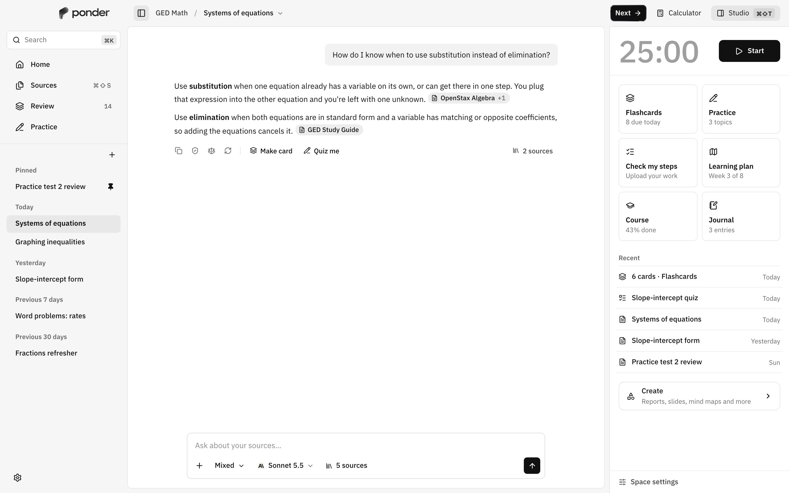

# Ponder

A free, open-source AI learning app for the desktop. Put your sources in a space, study them with a tutor that cites them, and turn them into flashcards, practice, worksheets and exams. Everything stays on your computer: no account, no server, no telemetry.



## What it does

- **Spaces and sources.** One space per subject. Import PDF, EPUB, DOCX, Markdown, web pages, YouTube transcripts, podcasts, or run deep research to find sources for you. Watched folders, Google Drive and Dropbox, a global quick-capture hotkey.
- **Grounded chat.** Answers cite your sources (click a citation to open the passage). Anything not from your sources is labeled. Direct, Socratic or mixed tutor style, learner memory, second opinion, self-check against the sources.
- **Practice that adapts.** Flashcards with FSRS review, quizzes, adaptive practice, a math step checker that finds the wrong step, worked-to-faded examples, a mistake notebook, mastery map and readiness score.
- **Exams and worksheets.** Timed mock exams (GED first) with rubric-graded essays, printable worksheets with answer keys, scientific and graphing calculators.
- **Studio.** Reports, mind maps, slide decks (PPTX/PDF), cheat sheets, timelines, diagrams, data tables, audio and video overviews, interactive explainers and Python/JS/C code cells.
- **Focus.** Pomodoro and other timers with a study buddy in the chat, break overlay, parking lot, low-energy mode, distraction nudge, ambient sound, Spotify control.
- **Plans and insights.** Goal + exam date + weekly hours → a study schedule that re-plans when you miss a day. Today view, retention curves, best study time.
- **Bring any model.** Anthropic, OpenAI, Google Gemini, OpenRouter, xAI, Groq, Mistral, DeepSeek, any OpenAI-compatible URL, or local models through Ollama, LM Studio or llama.cpp (found automatically on your network). Keys live in the OS keychain.
- **Works with other tools.** MCP server (`ponder mcp`) so agents like Claude Code can search your spaces, MCP client for tools in chat, `ponder://` links and a command line, study packs to share a space as one file.
- **20 languages**, right-to-left included, a dyslexia-friendly font and adjustable text size.

## Install

Builds for macOS, Windows and Linux are published on [Releases](https://github.com/Dom0Nom/Ponder/releases) when a version is tagged; until then, build from source (below). Builds are not code-signed yet: on macOS, right-click the app and choose Open the first time.

Then add a model provider in Settings (or during setup). A free option is a local model through [Ollama](https://ollama.com) or [LM Studio](https://lmstudio.ai); a cheap hosted option is an [OpenRouter](https://openrouter.ai) key.

## Known limitations

- The offline voice (Kokoro) speaks English only; other languages need a hosted speech provider.
- Voice chat has no barge-in: you can't interrupt the tutor by talking while it speaks.
- Builds are unsigned, and there is no auto-update yet.

## Build from source

Needs [Bun](https://bun.sh), [Rust](https://rustup.rs) and the [Tauri prerequisites](https://tauri.app/start/prerequisites/) for your OS.

```sh
bun install
bun run tauri dev      # run the app
bun run tauri build    # release bundle
```

`bun run dev` runs only the UI in a browser against a mocked backend (add `?seed` for a mock model).

## Tests

```sh
bun run typecheck
bun run test                   # Vitest + locale check
bun run e2e                    # Playwright against the mocked backend
cd src-tauri && cargo test     # Rust
```

## Project layout

- `src/` React + TypeScript UI. `src/lib/ipc.ts` lists every backend command; `src/test/mockBackend.ts` implements them in memory for the browser and tests.
- `src-tauri/` Rust backend: SQLite (FTS5 + sqlite-vec), ingest and local embeddings, keychain, the AI proxy, focus timer, MCP, OAuth.
- `docs/` spec, plan, roadmap and OAuth notes.

## Contributing

Pull requests are welcome, especially translation fixes. See [CONTRIBUTING.md](CONTRIBUTING.md). Report security issues privately as described in [SECURITY.md](SECURITY.md).

## License

MIT, see [LICENSE](LICENSE). The Ponder name, logo and display font are not covered by the MIT license; see [THIRD_PARTY_NOTICES.md](THIRD_PARTY_NOTICES.md).
